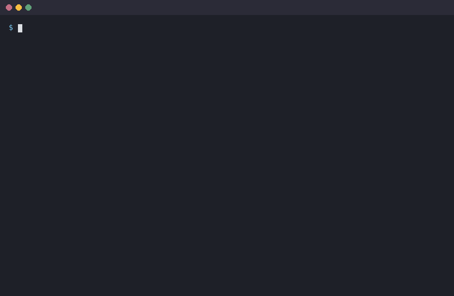

# grpc-observer

Observe client calls made with [`grpcio`](https://pypi.org/project/grpcio/): subclass an observer, override the
hooks you need (logging, Allure steps, metrics, anything) and plug it into a channel.

- sync channels and `grpc.aio` channels;
- all four call kinds: unary-unary, unary-stream, stream-unary, stream-stream;
- one hook per event, a guaranteed `on_call_end` per call, broken hooks never break calls.



<sub>[`examples/logging_observer.py`](examples/logging_observer.py) with a human-friendly formatter,
see [`docs/demo/demo.py`](docs/demo/demo.py).</sub>

**grpc-observer only observes.** It never changes requests, responses, metadata or statuses. To add auth or
metadata use [`grpc.metadata_call_credentials`](https://grpc.github.io/grpc/python/grpc.html#grpc.metadata_call_credentials)
or a separate interceptor.

## Install

```
pip install grpc-observer            # grpcio + protobuf only
pip install "grpc-observer[status]"  # also decode rich error status (google.rpc.Status)
```

Python 3.11+, grpcio 1.65.1+, protobuf 5.26+ (on Python 3.13 / 3.14 the first grpcio and protobuf releases that
support them). CI runs the tests on both the minimum and the latest versions.

## Quickstart

The examples below call `/echo.Echo/Echo` with `StringValue` messages so they run as is; with generated stubs
it works the same way: `EchoStub(channel)`. The test server answers with initial metadata `x-server-version` and
trailing metadata `x-request-cost`.

```python
import grpc
from google.protobuf.message import Message
from google.protobuf.wrappers_pb2 import StringValue

from grpc_observer import GrpcCall, GrpcObserver, GrpcResult, message_to_dict


class PrintObserver(GrpcObserver):
    def on_request(self, call: GrpcCall, request: Message) -> None:
        print("->", call.method, message_to_dict(request), "metadata:", call.metadata)

    def on_response(self, call: GrpcCall, response: Message) -> None:
        print("<-", call.method, message_to_dict(response))

    def on_call_end(self, call: GrpcCall, result: GrpcResult) -> None:
        print("==", call.method, result.code.name, f"{call.elapsed_ms:.1f} ms")
        print("   initial metadata:", result.initial_metadata)
        print("   trailing metadata:", result.trailing_metadata)


def echo_method(channel):
    return channel.unary_unary(
        "/echo.Echo/Echo",
        request_serializer=StringValue.SerializeToString,
        response_deserializer=StringValue.FromString,
    )


# sync channel
with grpc.insecure_channel(target) as channel:
    channel = grpc.intercept_channel(channel, PrintObserver().interceptor())
    echo = echo_method(channel)
    assert echo(StringValue(value="hi"), metadata=(("x-client", "readme"),)).value == "HI"
```

```
-> /echo.Echo/Echo hi metadata: {'x-client': 'readme'}
<- /echo.Echo/Echo HI
== /echo.Echo/Echo OK 2.1 ms
   initial metadata: {'x-server-version': '1.4.2'}
   trailing metadata: {'x-request-cost': '3'}
```

What the hooks get:

- `request`, `response` and stream messages are the deserialized protobuf objects, the very `request` you passed to
  the stub and the `response` it returns: `StringValue` here, `GetUserRequest` / `User` with generated code. Hooks
  are typed with their common base class `google.protobuf.message.Message` because one observer sees every method
  of the channel; narrow with `isinstance(request, GetUserRequest)` when you need the concrete fields, or turn any
  message into a dict with `message_to_dict` (well-known wrappers like `StringValue` become plain values, as above).
- `call.metadata` is the request metadata, `result.initial_metadata` / `result.trailing_metadata` are what the server
  sent, all as `dict[str, str | bytes]` (keys ending in `-bin` hold `bytes`). Both server metadata come in `on_error`
  too, so a failed call can still be logged with them.

The same observer works with a `grpc.aio` channel. Note the plural: `aio_interceptors()` returns a list.

```python
import asyncio


async def main():
    async with grpc.aio.insecure_channel(target, interceptors=PrintObserver().aio_interceptors()) as channel:
        echo = echo_method(channel)
        assert (await echo(StringValue(value="hi"))).value == "HI"


asyncio.run(main())
```

When a hook needs to `await` something (an async logger, a queue, a database), subclass `AsyncGrpcObserver`
and write `async def` hooks. Several observers on one channel are just concatenated lists:

```python
from grpc_observer import AsyncGrpcObserver

calls = []


class CollectingObserver(AsyncGrpcObserver):
    async def on_call_end(self, call, result) -> None:
        await asyncio.sleep(0)  # e.g. await queue.put(...)
        calls.append((call.method, result.code.name))


async def main():
    observers = [*PrintObserver().aio_interceptors(), *CollectingObserver().aio_interceptors()]
    async with grpc.aio.insecure_channel(target, interceptors=observers) as channel:
        await echo_method(channel)(StringValue(value="hi"))


asyncio.run(main())
assert calls == [("/echo.Echo/Echo", "OK")]
```

## Which class goes with which channel

| Observer                                | sync channel (`grpc.intercept_channel`) | `grpc.aio` channel (`interceptors=`) |
|-----------------------------------------|-----------------------------------------|--------------------------------------|
| `GrpcObserver` (`def` hooks)            | `observer.interceptor()`                | `observer.aio_interceptors()`        |
| `AsyncGrpcObserver` (`async def` hooks) | `TypeError`                             | `observer.aio_interceptors()`        |

Wrong wiring fails immediately and with a clear message, when the interceptor is created:

```python
import pytest


class Wrong(GrpcObserver):
    async def on_call_end(self, call, result): ...  # async hook in a sync observer


with pytest.raises(TypeError, match="async hooks"):
    Wrong().interceptor()

with pytest.raises(TypeError, match="grpc.aio channels only"):
    CollectingObserver().interceptor()  # AsyncGrpcObserver in a sync channel
```

## Hook contract

All hooks are no-ops by default; override only what you need.

```
on_call_start(call)
on_request(call, request)                   unary request      | on_request_message(call, message, index)  × N  request stream
on_response(call, response)                 unary response     | on_response_message(call, message, index) × N  response stream
on_error(call, result)                      only if status != OK
on_call_end(call, result)                   always, exactly once
```

- In bidi streams request and response messages may interleave.
- An exception raised in a hook is logged (logger `grpc_observer`) and swallowed: a broken observer never
  breaks the call.
- A cancelled call ends with `on_call_end` and status `CANCELLED`. See [Cancelled and abandoned streams](#cancelled-and-abandoned-streams).

`GrpcCall` is created per call and passed to every hook:

| field                     | meaning                                                              |
|---------------------------|----------------------------------------------------------------------|
| `method`                  | full method name, `/package.Service/Method`                          |
| `kind`                    | `CallKind`, with `.request_streaming` / `.response_streaming`        |
| `metadata`, `timeout`     | as seen by this observer's interceptor                               |
| `wait_for_ready`          | as passed to the call, `None` if not set                             |
| `target`                  | channel address, if given to `interceptor(target=...)` / `aio_interceptors(target=...)`; grpc does not tell interceptors which channel they are on |
| `request_id`              | random UUID, handy to correlate log lines                            |
| `started_at`, `elapsed_ms`| monotonic start time and time since start                            |
| `state`                   | free-form `dict` for the observer, lives as long as the call         |

`GrpcResult` is passed to `on_error` and `on_call_end`: `code`, `details`, `initial_metadata`,
`trailing_metadata`, `status` (decoded rich status, see below), `exception`, `request_count`, `response_count`
(messages in request / response streams, `0` for unary sides) and `ok`.

## Your own fields on the call

Anything you want next to every log line (trace id, test name, tenant) goes into a `GrpcCall` subclass. Parametrize
the observer with it: the interceptors then create your class for every call, and type checkers and IDEs know its
fields in every hook. Fill the fields in `on_call_start`: it runs in the caller's thread / task, so context
variables are visible there (unlike `on_request_message` in sync channels, which runs in a gRPC worker thread).

```python
import contextvars
from dataclasses import dataclass

current_trace_id = contextvars.ContextVar("trace_id", default="-")


@dataclass
class TracedCall(GrpcCall):
    trace_id: str = ""  # own fields need defaults: the interceptor creates the call with grpc's fields only


class TracingObserver(GrpcObserver[TracedCall]):
    def on_call_start(self, call: TracedCall) -> None:
        call.trace_id = current_trace_id.get()

    def on_call_end(self, call: TracedCall, result: GrpcResult) -> None:
        print(f"[{call.trace_id}] {call.target}{call.method} {result.code.name}")


current_trace_id.set("4bf92f35")
with grpc.insecure_channel(target) as channel:
    channel = grpc.intercept_channel(channel, TracingObserver().interceptor(target=target))
    echo_method(channel)(StringValue(value="hi"))
```

```
[4bf92f35] 127.0.0.1:50051/echo.Echo/Echo OK
```

The same works with `AsyncGrpcObserver[TracedCall]`. Without type parameters you can set `call_class = TracedCall`
on the observer instead. For quick untyped notes there is `call.state`, a plain dict.

## Observes only, and interceptor order

An observer sees the call exactly as its own interceptor receives it. If another interceptor adds metadata and
the observer should see it, put the observer **after** that interceptor:

```python
class AddMetadata(grpc.aio.UnaryUnaryClientInterceptor):
    async def intercept_unary_unary(self, continuation, details, request):
        metadata = [*(details.metadata or ()), ("x-tenant", "acme")]
        return await continuation(details._replace(metadata=metadata), request)


seen = []


class MetadataObserver(GrpcObserver):
    def on_call_start(self, call):
        seen.append(call.metadata.get("x-tenant"))


async def main():
    interceptors = [*MetadataObserver().aio_interceptors(), AddMetadata(), *MetadataObserver().aio_interceptors()]
    async with grpc.aio.insecure_channel(target, interceptors=interceptors) as channel:
        await echo_method(channel)(StringValue(value="hi"))


asyncio.run(main())
assert seen == [None, "acme"]  # before AddMetadata / after AddMetadata
```

For sync channels the order of `grpc.intercept_channel(channel, a, b)` works the same way.

## Thread safety

In **sync** channels gRPC reads request streams in a worker thread, so `on_request_message` (stream-unary and
stream-stream calls) runs outside the calling thread. Keep these hooks thread-safe — and therefore anything they
touch in `call.state` or on the observer. Other hooks run in the calling thread, or in the thread that completes
a unary future. One observer instance serves all calls on a channel, possibly concurrently: keep per-call data in
`call.state`, not on `self`.

## A slow async hook slows the call

`AsyncGrpcObserver` hooks are awaited inline: the call does not proceed until the hook returns. A hook that takes
100 ms adds 100 ms to the call (and to every stream message). Offload heavy work to a background task or a queue.

## Cancelled and abandoned streams

- `call.cancel()`, a cancelled `asyncio` task, a deadline or a closed channel end the call with `on_call_end`
  (`CANCELLED` / `DEADLINE_EXCEEDED`).
- `break` out of `async for` does **not** end the RPC in grpc.aio: it keeps running until the call is cancelled
  or the channel is closed, and `on_call_end(CANCELLED)` fires at that moment. Call `call.cancel()` after `break`
  if you want it right away. A stream that is never closed gets `on_call_end(CANCELLED)` when the event loop
  shuts down.
- Before grpcio 1.83 closing a `grpc.aio` channel does not end the calls still running on it, so for such an
  abandoned stream `on_call_end(CANCELLED)` comes only at event loop shutdown.

## Rich error status

If the server sends a rich status (`grpc-status-details-bin` trailer), it is removed from `trailing_metadata` and
decoded into `result.status` as a dict, e.g. `{"code": 3, "message": "boom", "details": [...]}`. Decoding needs
`grpc-observer[status]` (`googleapis-common-protos`). Without it, or if the bytes can't be decoded, you get
`{"raw": "<base64>"}`.

## Helpers

`message_to_dict(message)` converts a protobuf message to a dict (fields with default values included).
`json_default` is a `default=` for `json.dumps` that handles binary metadata, protobuf messages and enums:

```python
import json

from grpc_observer import json_default, message_to_dict

assert message_to_dict(StringValue(value="hi")) == "hi"  # well-known types map to plain JSON values
assert json.dumps({"bin": b"\x00"}, default=json_default) == '{"bin": "AA=="}'
```

## Examples

Ready-to-use observers live in [`examples/`](examples) (they are not part of the package — copy and adapt):

- [`logging_observer.py`](examples/logging_observer.py) — stdlib `logging`, one record per event;
- [`allure_observer.py`](examples/allure_observer.py) — one Allure step per call with request / response / error
  attachments.

Each file runs as a script against a local echo server: `python examples/logging_observer.py`.

## Roadmap

Not in 0.1:

- server-side observers;
- masking of sensitive fields;
- truncation of large messages;
- OpenTelemetry bridge;
- `raise_errors` flag to re-raise hook exceptions (handy in tests).

## License

MIT
